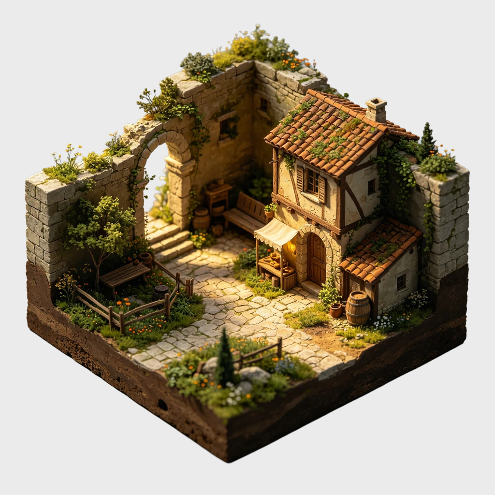
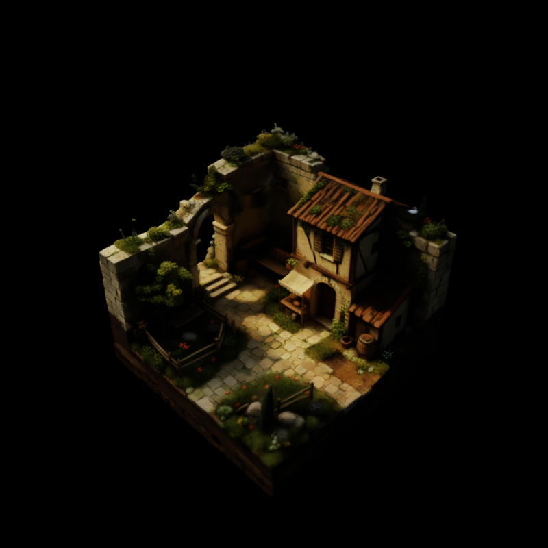
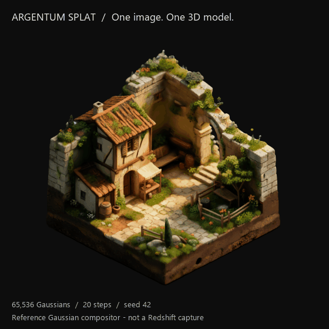

<h1 align="center">Argentum Splat</h1>

<strong>Free Gaussian Splatting plugin for Cinema 4D 2027 and Redshift.</strong> Generate 3D from a single image, reconstruct a scene from photographs, or import an existing Gaussian scan.

  <a href="https://github.com/OlehandroStox/argentum-splat/releases/download/v0.9.2/ArgentumSplat-0.9.2-C4D2027-Windows.zip"><strong>Download 0.9.2 for Windows</strong></a> ·
  <a href="#install">Install</a> ·
  <a href="README.ru.md">Русский</a> ·
  <a href="https://boosty.to/olehandrostox/donate">Support the author</a>

## See the result

| Input image | Cinema 4D / Redshift render |
| --- | --- |
|  |  |

The still is a Redshift render. The turntable shows the exported model in a separate Gaussian viewer. [Media credits](docs/media/README.md).

## Features

- **Single Image:** local TripoSplat AI generation from one still picture. Gaussian Count presets and Custom cover 32,768–1,048,576 points; counts above 262,144 are experimental.
- **Multi-Photo Scan:** reconstruct one stationary subject or scene from **3–500 overlapping photographs** using PyCOLMAP and Brush. Separate setup, alignment diagnostics, training controls, cancellation and automatic import; no Image AI weights required.
- **Redshift Linear training:** new photo scans train in linear colour by default. Lossless processing copies and embedded ICC handling preserve photo detail; the PLY stores its colour space and Gaussian profile. Choose sRGB training for conventional external viewers.
- **Captured cameras:** saved calibrated views and their aspect ratios; use **Captured View → Use Captured Camera** to return to a photographed viewpoint.
- **Scan import:** Gaussian PLY, SPLAT, SPZ, SOG and KSPLAT, with LOW / MEDIUM / HIGH / MAX import quality and a memory estimate before large imports.
- **Redshift materials:** editable colour correction, stored view-dependent SH colour, emission/diffuse/subsurface weights and matching per-mesh Gaussian profiles. The transparency-quality action creates a separate render-settings preset and preserves the original.
- **MoGraph:** create a Fracture rig and animate splat cards with effectors.
- **Responsive workflow:** point preview, bounded geometry updates, cached scan data, optional bundled NumPy acceleration, progress and cancellation.
- **Offline Help:** English and Russian instructions in a separate reader, plus status in every plugin tab.

Media is processed locally. No paid API key or plugin subscription is required.

## Install

1. [Download the ZIP](https://github.com/OlehandroStox/argentum-splat/releases/download/v0.9.2/ArgentumSplat-0.9.2-C4D2027-Windows.zip) and extract it.
2. Close Cinema 4D and run **ArgentumSplat/Install.cmd**. The installer sets up the plugin, private Python and required components.
3. Start Cinema 4D → **Extensions → ArgentumSplat → Argentum Splat**.

**Requirements:** Windows x64, Cinema 4D 2027 and Redshift. The Image AI mode also needs an NVIDIA Ampere-or-newer GPU with BF16 support and a compatible driver. The first setup downloads several GB; manual Python installation is unnecessary. Importing existing scans does not require AI model weights.

[Installation options and troubleshooting](docs/installation.md).

## First steps

**Single Image:** choose Image File → Generate from Image.

**Multi-Photo Scan:** run **Set Up Photos** once, choose **Photos Folder**, then **Reconstruct from Photos**. Start with 10–50 sharp, overlapping photographs of a stationary subject. New scans default to 30,000 training steps and a maximum of 1,000,000 Gaussians; the final count depends on the reconstruction. Photos needs its own compatible GPU runtime; see the [Photos setup guide](docs/installation.md#photos).

**0.9.2:** Photos now trains in linear colour for Redshift and imports using the matching Gaussian profile. Lossless processing copies preserve detail, and colour/profile metadata travels inside the PLY. Choose sRGB training for conventional external splat viewers. Existing sRGB scans need reconstruction for the full colour improvement.

**From an existing scan:** choose it in **SCAN → Splat File**. New objects use MAX to retain all splats that pass the opacity filter, if memory permits. Choose a lower **Import Quality** for drafts.

In an empty scene the plugin prepares Redshift and fits a camera automatically. For a scan added to an existing scene, use your camera or **SCAN → Manual Tools → Frame Loaded Scan**.

For control explanations, open **Help → Language / Язык** in the plugin, or read the [control guide](docs/controls.md). The installed version is shown at the bottom of Help.

## Useful to know

- Image accepts a single still picture. Video and image-sequence decoding were removed in 0.9.0. Multi-Photo Scan reconstructs observed surfaces; unseen sides require more photographs.
- Keep `generation.json` and `capture-cameras.json` beside the reconstructed PLY when moving a scan so its calibrated views remain available.

- A Gaussian model is not a watertight polygon mesh. Redshift uses Gaussian cards, so its appearance can differ from other viewers.
- Large scans need more RAM and preparation time. **Preview Points** affects editor drawing; **Import Quality** affects loaded geometry.
- Automatic framing checks SOG capture-space detail for an interior view, ignores distant background tails when fitting an outdoor scene, and otherwise uses an overview. It cannot recover an unknown original camera or missing source detail.

## Support and feedback

The plugin is free. If it helps your work, you can [support the author on Boosty](https://boosty.to/olehandrostox/donate), star the repository or [report a problem](https://github.com/OlehandroStox/argentum-splat/issues).

## License and credits

By [OlehandroStox / ARGENTUM](https://github.com/OlehandroStox). The integration is [MIT licensed](LICENSE). Multi-photo reconstruction uses PyCOLMAP and Brush. Single-image AI generation uses [TripoSplat](https://github.com/VAST-AI-Research/TripoSplat); format conversion uses [PlayCanvas splat-transform](https://github.com/playcanvas/splat-transform). Built with DINOv3. Dependencies and model components retain their [own licenses](ArgentumSplat/backend/THIRD_PARTY_NOTICES.md). Independent project; not affiliated with Maxon.
