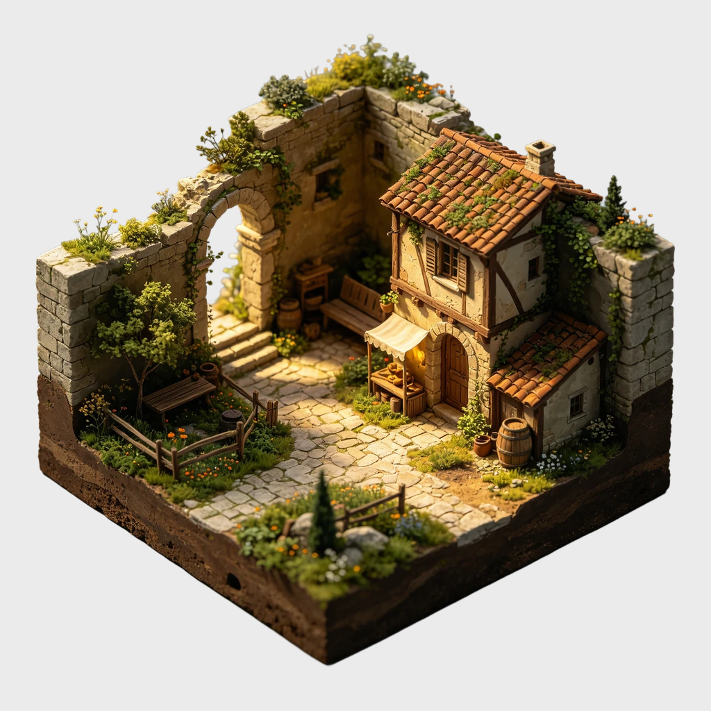
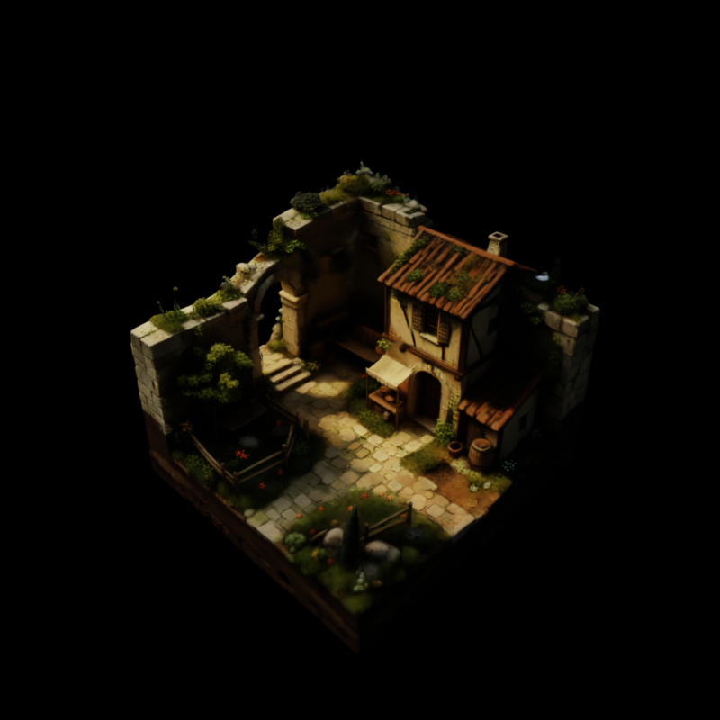
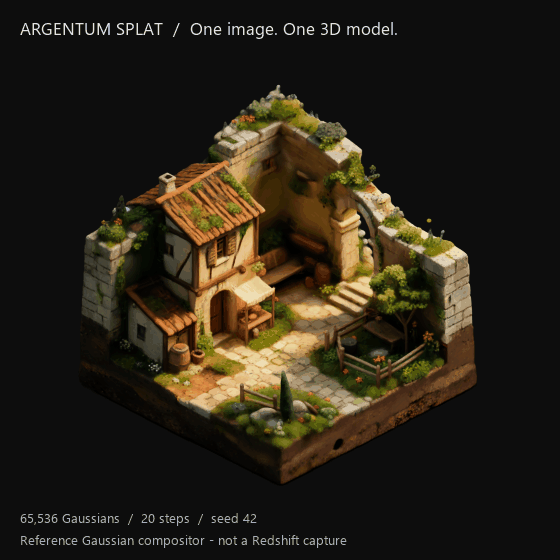

<h1 align="center">Argentum Splat</h1>

<strong>Бесплатный Gaussian Splatting плагин для Cinema 4D 2027 и Redshift.</strong> Создавайте 3D по изображению, импортируйте сканы и работайте с ними в Cinema 4D.

  <a href="https://github.com/OlehandroStox/argentum-splat/releases/download/v0.8.2/ArgentumSplat-0.8.2-C4D2027-Windows.zip"><strong>Скачать 0.8.2 для Windows</strong></a> ·
  <a href="#установка">Установка</a> ·
  <a href="README.md">English</a> ·
  <a href="https://boosty.to/olehandrostox/donate">Поддержать автора</a>

## Пример результата

**0.8.2:** уменьшены задержки создания геометрии, исправлены отмена и повторные загрузки, добавлены проверки памяти и исправлен профиль прозрачности SuperSplat. Подробности — в [списке изменений](CHANGELOG.md) и [описании ограничений рендера](docs/rendering-compatibility.ru.md). Различия смешивания цвета и плотных прозрачных слоёв в Redshift остаются.

| Исходное изображение | Рендер Cinema 4D / Redshift |
| --- | --- |
|  |  |

Статичное изображение — рендер Redshift. Вращение показывает экспортированную модель в отдельном Gaussian-просмотрщике. [Авторы демонстрационных материалов](docs/media/README.md).

## Возможности

- **Изображение в 3D:** локальная AI-генерация по фото или выбранному кадру видео/секвенции.
- **Импорт сканов:** Gaussian PLY, SPLAT, SPZ, SOG и KSPLAT.
- **Import Quality:** LOW, MEDIUM, HIGH или MAX, с оценкой памяти перед крупным импортом.
- **Redshift:** редактируемый материал, цветокоррекция и сохранённый зависимый от ракурса цвет.
- **MoGraph:** создание Fracture для работы эффекторов с карточками сплатов.
- **Удобная работа:** предпросмотр точками, повторное использование расчётов, прогресс и отмена.
- **Встроенный Help:** инструкция на русском и английском без интернета.

Медиа обрабатываются локально. Платный API-ключ или подписка на плагин не нужны.

## Установка

1. [Скачайте ZIP](https://github.com/OlehandroStox/argentum-splat/releases/download/v0.8.2/ArgentumSplat-0.8.2-C4D2027-Windows.zip) и распакуйте его.
2. Закройте Cinema 4D и запустите **ArgentumSplat/Install.cmd**. Установщик подготовит плагин, отдельный Python и необходимые компоненты.
3. Откройте Cinema 4D → **Extensions → ArgentumSplat → Argentum Splat**.

**Требования:** Windows x64, Cinema 4D 2027 и Redshift. Для AI-генерации дополнительно нужна NVIDIA Ampere или новее с поддержкой BF16 и совместимым драйвером. Первая установка скачивает несколько ГБ; вручную устанавливать Python не нужно. Для импорта готовых сканов веса AI не требуются.

[Варианты установки и решение проблем, English](docs/installation.md).

## Первый запуск

**Из фото или видео:** выберите файл в **INPUT**, при необходимости укажите кадр и нажмите **Generate from Image / Video**. Дождитесь **Ready** в Status и запустите Redshift.

**Из готового скана:** выберите файл в **SCAN → Splat File**. Новые объекты используют MAX: сохраняют все сплаты, прошедшие фильтр прозрачности, если хватает памяти. Для черновика можно снизить **Import Quality**.

В пустой сцене плагин автоматически подготовит Redshift и подберёт камеру. При добавлении в готовую сцену используйте свою камеру или **SCAN → Manual Tools → Frame Loaded Scan**.

Описание настроек — во вкладке **Help → Language / Язык** плагина и в [русской инструкции](docs/controls.ru.md). Версия установленного плагина указана внизу Help.

## Полезно знать

- Видео и секвенция дают **один кадр для одной статичной модели**, а не анимированную 3D-модель или многоракурсный скан.
- Gaussian-модель не является замкнутой полигональной сеткой. Redshift отображает её карточками, поэтому вид может отличаться от других просмотрщиков.
- Большие сканы требуют больше памяти и времени. **Preview Points** влияет на точки в редакторе, **Import Quality** — на загруженную геометрию.
- Автокадрирование проверяет детальность вида из начала координат SOG для интерьеров, исключает дальний фон из расчёта камеры для протяжённых сцен и использует общий вид для предметов. Исходная камера и отсутствующие детали не могут быть восстановлены из любого файла.

## Поддержка и обратная связь

Плагин бесплатный. Если он помогает в работе, можно [поддержать автора на Boosty](https://boosty.to/olehandrostox/donate), поставить звезду репозиторию или [сообщить об ошибке](https://github.com/OlehandroStox/argentum-splat/issues).

## Лицензия и авторы

Автор: [OlehandroStox / ARGENTUM](https://github.com/OlehandroStox). Интеграция распространяется по [MIT](LICENSE). AI-генерация использует [TripoSplat](https://github.com/VAST-AI-Research/TripoSplat), конвертация — [PlayCanvas splat-transform](https://github.com/playcanvas/splat-transform). Built with DINOv3. Зависимости и компоненты моделей сохраняют [свои лицензии](ArgentumSplat/backend/THIRD_PARTY_NOTICES.md). Независимый проект, не связанный с Maxon.
